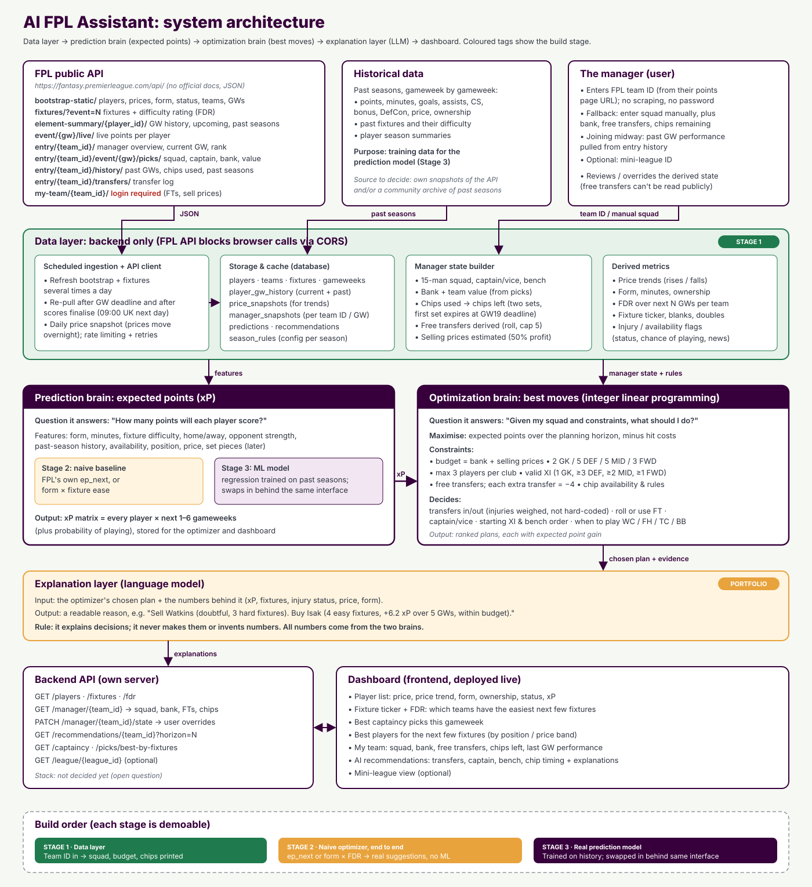

# AI FPL Assistant

Paste a Fantasy Premier League team ID and get your situation, then (in later stages) the best transfers, captain, bench order and chip timing, each explained in plain English.



The system is split into a **prediction brain** (how many points will each player score?), an **optimization brain** (given my squad and the rules, what should I do?) and an **explanation layer** (a language model that explains the optimizer's choice and never makes it). They connect through one interface: an expected-points matrix of player × gameweek. Full spec: [docs/fpl_ai_project_spec.md](docs/fpl_ai_project_spec.md). Decisions and their reasons: [DECISIONS.md](DECISIONS.md).

## Status

| Stage | What | State |
|---|---|---|
| 1 | Data layer: team ID → squad, bank, free transfers, chips | **Done (local)** |
| 2 | Optimizer end to end on a baseline predictor (no ML) | **Done (local)**: transfers, captain, bench, chip timing |
| 3 | Trained prediction model behind the same interface | Not started |

## What works now

- `GET /manager/{team_id}` rebuilds a manager's situation from public FPL endpoints only. There's no login and no password.
- Values FPL doesn't publish are **derived and labelled as such**:
  - **Free transfers**: replayed gameweek by gameweek from the transfer history, and checked against FPL's own hit charges. You can correct the result (`PATCH /manager/{team_id}/state`).
  - **Selling prices**: purchase price plus half of any rise, rounded down.
  - **Chips left**: from the chips you've played and the season's chip windows.
- Every rule (budget, squad shape, club limit, transfer cap, hit cost, chip windows) lives in [`backend/app/rules/2026_27.toml`](backend/app/rules/2026_27.toml) and is checked against the live API on every refresh.
- A scheduled ingest stores players, teams, gameweeks and fixtures, plus a daily price snapshot for price trends.
- **Recommendations** (`GET /recommendations/{team_id}?horizon=5`): an integer linear program (HiGHS) plans transfers, hits, captain, starting XI, bench and **chip timing** (Wildcard, Free Hit, Triple Captain, Bench Boost) over the next 1 to 8 gameweeks. It returns the best plan and an alternative, each with its expected gain over doing nothing and the facts behind every move, plus play-or-save advice for every chip still held.
- **Predictions** come from a transparent baseline: form and season scoring rate, × fixture difficulty, × availability (including return dates parsed from injury news). They sit behind one `XPMatrix` interface, so the Stage 3 model can replace them without touching anything else.
- **Dashboard views:** player list with prices, price changes and xP (`/players`); fixture difficulty ticker (`/fdr`); best captains (`/captaincy`); best players for the coming fixtures (`/picks/best-by-fixtures`).

## Run it locally

You need Python 3.12, Node 20 or later, and Docker.

```bash
docker compose up -d
```

```bash
cd backend
python -m venv .venv
.venv/Scripts/pip install -e ".[dev]"   # macOS/Linux: .venv/bin/pip
.venv/Scripts/alembic upgrade head
.venv/Scripts/python -m app.ingest.run
.venv/Scripts/uvicorn app.main:app --reload
```

```bash
cd frontend
npm install
npm run dev
```

Open http://localhost:5173 and enter a team ID: it's the number in the address of your FPL Points page. The API docs are at http://localhost:8000/docs.

Tests: `cd backend && .venv/Scripts/pytest`.

## Layout

```
backend/app/
  fpl/        the only code that talks to FPL: caching, rate limiting, retries, validation
  rules/      per-season game rules + checks against the live API
  manager/    ManagerState, its builder, and the free-transfer / chip / selling-price derivations
  prediction/ the prediction brain: XPMatrix interface + the baseline predictor
  optimization/ the optimization brain: the ILP solver and plan building
  insights.py dashboard views (player list, fixture ticker)
  db/         tables (SQLAlchemy); migrations in backend/migrations (Alembic)
  ingest/     scheduled refresh + daily price snapshot (python -m app.ingest.run)
  main.py     HTTP API (FastAPI)
frontend/     React + Vite + TypeScript + Tailwind
.github/      CI (tests + build) and the scheduled ingest
```

## Honest limits

- **Free transfers and selling prices are estimates.** The exact values are only visible when logged in to FPL. The derivation re-syncs whenever FPL's hit charges disagree with it, and you can always override it.
- **Transfers made since the last deadline aren't public** until the next deadline passes, so the squad shown is the one at the last deadline.
- **The baseline predictor is deliberately simple.** Its fixture multipliers are hand-set, it knows nothing about underlying stats, minutes or set pieces, and FPL's team strength ratings are empty this season. Stage 3 replaces it with a trained model.
- **The FPL API is unofficial** and changes without notice. Everything goes through one validated client, so a change fails loudly in one place.
