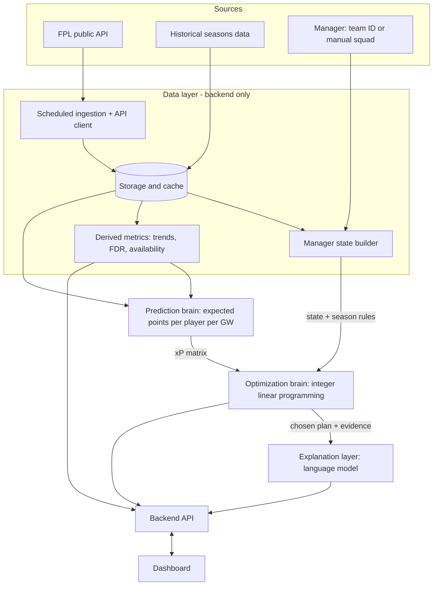

# AI FPL Assistant: Project Specification

*Working title. Status: planning / brainstorming complete, nothing built yet. Last updated: 14 October 2026 (FPL season 2026/27 in progress).*

This document captures everything decided so far for the project, plus verified facts about the game and its data. Sections are tagged so an implementer can tell what is **decided**, what is **verified fact**, what is a **suggestion** (not yet agreed), and what is still **open**.

| Tag | Meaning |
|---|---|
| **[DECIDED]** | Agreed by the project owner. Treat as a requirement. |
| **[FACT]** | Verified from research. May change between seasons; re-check at the start of each season. |
| **[SUGGESTION]** | Proposed during planning but not explicitly agreed. Use as a sensible default, confirm before committing. |
| **[OPEN]** | Not decided. Ask the project owner before choosing. |

---

## 1. One-paragraph summary

A web dashboard for Fantasy Premier League (FPL) managers. A manager enters their FPL team ID (or their squad manually). The system pulls live game data, works out the manager's exact situation (squad, money in the bank, free transfers, chips left), predicts how many points every player is likely to score over the next few gameweeks, and then uses optimization to recommend the best moves: which transfers to make, who to captain, bench order, and when to play chips. A language model turns each recommendation into a plain-English explanation. Alongside the recommendations, the dashboard is a comprehensive FPL view similar to what popular FPL YouTube channels show: updated player list with prices and price trends, upcoming fixtures, fixture difficulty, best captaincy picks, and best players for the coming fixtures.

**Purpose [DECIDED]:** portfolio project. That shapes priorities (see section 7).

---

## 2. The game: FPL rules relevant to the system

### 2.1 Core mechanics (as described by the project owner) [DECIDED / FACT]

- Managers pick a squad of players at the start of the season, choosing players they think will do well.
- Each gameweek, players score points based on their real-match performance; the manager's team total is the sum of their players' points. The goal is to maximise points every week.
- Managers get **one free transfer per gameweek**.
- **Chips:**
  - **Triple Captain**: captain scores triple instead of double for one gameweek.
  - **Bench Boost**: bench players' points also count for one gameweek.
  - **Wildcard**: unlimited free transfers, **permanent**.
  - **Free Hit**: unlimited free transfers for **one gameweek only**; the squad reverts afterwards.
- Managers join leagues: private mini-leagues made with friends, or public leagues.

### 2.2 Season 2026/27 specifics (verified October 2026) [FACT]

The owner described "four chips". For 2026/27 the rules are more detailed; the system must model these:

- **Two sets of chips (eight total):** Wildcard, Free Hit, Triple Captain and Bench Boost, one set for each half of the season.
- **First set expires at the Gameweek 19 deadline** and cannot be carried over; the set refreshes for the second half.
- **Free Hit restrictions:** cannot be played in GW1; if the first Free Hit is played in GW19 the second cannot be played in GW20 (no back-to-back Free Hits).
- **Assistant Manager chip** (introduced 2024/25) has been **removed** for 2026/27.
- **Free transfers roll over, up to a maximum of 5 banked.**
- **Extra transfers cost −4 points each** (a "hit").
- **No extra December free transfers** this season (2025/26 had them for AFCON).
- **Squad framework:** 15 players, £100.0m budget, maximum 3 players from any one club.
- **Squad composition:** 2 GK, 5 DEF, 5 MID, 3 FWD. Starting XI: 1 GK, at least 3 DEF, at least 2 MID, at least 1 FWD.
- **Captain** scores double; vice-captain takes over if the captain doesn't play.
- **Defensive contribution (DefCon) points** exist and remain in 2026/27.
- **Bonus Points System was rebalanced** for 2026/27 (to reduce overlap with DefCon).
- **Live points** now update during matches; **scores finalise at 09:00 UK time the day after the gameweek's final match.**
- **Prices change daily** based on net transfers.
- **Selling price rule:** a player's selling price is their purchase price plus 50% of any rise, rounded down to £0.1m. (Long-standing rule; re-verify.)
- **Playing a Wildcard or Free Hit does not wipe banked free transfers** (current behaviour; re-verify each season).

> **Design implication [SUGGESTION]:** keep all of the above in a per-season `season_rules` config (budget, squad shape, club limit, FT cap, hit cost, chip list, chip windows, chip restrictions), never hard-coded, because FPL changes rules most summers.

---

## 3. What the project owner wants [DECIDED]

### 3.1 Inputs about the manager

- A way for the user to **put in their team**, ideally by fetching it automatically ("scrape the data from their accounts or something like that"). Agreed approach: **team ID** via the public API, no scraping, no password (section 4).
- If the user is **joining midway** through the season, get their **previous weeks' performance**.
- Collect:
  - **chip statuses** (which chips are still available),
  - **number of free transfers**,
  - **money in the bank**.

### 3.2 The dashboard (comprehensive FPL view)

Modelled on what FPL YouTube channels show:

- **Updated player list** with all players' **current prices** and **trends** (price movement, form).
- **Upcoming fixtures**.
- **Fixture difficulty rating (FDR)**.
- **Best captaincy picks** for the gameweek.
- **Best players for the next few fixtures**.
- **Which teams/players have the easiest fixtures**.

### 3.3 The AI

- Given the user's current situation (free transfers, chips available, bank, squad), work out **the best strategy** for them.
- Recommend **the best transfer to make**.
- Example given: if the user has injured players, that might be the most important transfer, **but the AI should decide** what's best rather than following fixed rules. Injuries are an input to be weighed, not an automatic trigger.
- Decisions must be **data-driven**: current player data, **past seasons' history**, fixtures, etc.
- The owner was unsure whether to **build** their own model or **use** an existing one. Resolution below (section 5).

---

## 4. Data access: research findings [FACT]

### 4.1 The FPL API

- Base URL: `https://fantasy.premierleague.com/api/`
- Unofficial: **no official documentation**; endpoints are known from community write-ups. Responses are JSON.
- **CORS:** the API cannot be called from a browser front end. **All calls must go through our own backend** (which also lets us cache and rate-limit).
- `bootstrap-static/` is large (~2 MB) but returns in about a second. Be polite: cache it, and space out per-player calls.

### 4.2 Endpoints and what we use them for

| Endpoint | Auth | Gives us | Used for |
|---|---|---|---|
| `bootstrap-static/` | none | All players (price, form, total points, status, news, chance of playing, ownership, FPL's own `ep_next` expected points), all teams (with strength ratings), all gameweeks (deadlines, averages, most captained), scoring rules | Player list, prices, trends, baseline predictions, availability flags |
| `fixtures/` and `fixtures/?event={gw}` | none | Every fixture with home/away team, kickoff, result, and difficulty for each side | Fixture ticker, FDR, prediction features |
| `element-summary/{player_id}/` | none | Player's gameweek-by-gameweek history this season, upcoming fixtures, past-season totals | Form trends, model features |
| `event/{gw}/live/` | none | Live/final points breakdown per player for a gameweek | Live view, post-GW data |
| `entry/{team_id}/` | none | Manager overview: name, overall rank, current gameweek, leagues | Identify manager |
| `entry/{team_id}/event/{gw}/picks/` | none | That gameweek's 15 picks, captain/vice, bench order, active chip, and `entry_history` (points, **bank**, **team value**, transfers made, transfer cost) | Squad, bank |
| `entry/{team_id}/history/` | none | Points per past gameweek this season, **chips used (and when)**, past seasons' summaries | Previous performance when joining midway; chips remaining |
| `entry/{team_id}/transfers/` | none | Full transfer log with purchase prices | Free transfer derivation, selling price estimates |
| `leagues-classic/{league_id}/standings/` | none | Mini-league standings | Optional league view |
| `my-team/{team_id}/` | **login** | Exact free transfers available, chip status, exact selling prices | Not used by default (see 4.3) |

### 4.3 Correction to an earlier statement in the planning chat

During the conversation it was said that the public `entry` endpoint gives chip status, free transfers and bank directly with no login. That was **partly wrong**:

- **Bank and team value**: available publicly (from `picks` → `entry_history`). ✅
- **Chips remaining**: not given directly, but **derivable** from `entry/{id}/history/` (chips used + the season's chip rules). ✅ derived
- **Free transfers available**: **not public**. Exact value is only in the login-only `my-team` endpoint. Can be **derived** by replaying the season (start count, +1 per gameweek, cap 5, minus transfers made, chip effects), but derivation can drift if rules or edge cases differ.
- **Exact selling prices**: login-only; **estimable** from transfer history purchase prices + current prices + the 50% rule.

**Agreed handling [SUGGESTION]:** derive everything possible from public endpoints, show it to the user, and let them **confirm or override** (especially free transfers). Never ask for or store FPL passwords.

### 4.4 Historical data

- Needed to train the Stage 3 prediction model ("previous past year's history data").
- Sources [OPEN]: our own nightly snapshots going forward, `element-summary` past-season totals, and/or a community archive of past seasons' gameweek-level data. Pick one and record its licence.

---

## 5. Architecture [DECIDED]

The system splits into layers. The key agreed insight: **the AI is really two different "brains" plus an explainer**, and they are built differently.



(A visual version is in `fpl_ai_architecture.svg`.)

### 5.1 Data layer

- **Ingestion + API client** (backend): pulls `bootstrap-static` and `fixtures` on a schedule; re-pulls after each deadline and after scores finalise; takes a **daily price snapshot** so price trends can be shown (the API only gives current price plus this-gameweek change). Rate limiting, retries, caching.
- **Storage** [SUGGESTION, schema sketch]: `players`, `teams`, `fixtures`, `gameweeks`, `player_gw_history`, `price_snapshots`, `manager_snapshots`, `predictions`, `recommendations`, `season_rules`.
- **Manager state builder:** given a team ID, produce one object:
  ```
  ManagerState {
    team_id, gameweek,
    squad: 15 x {player_id, position, purchase_price, est_selling_price, is_captain, is_vice, bench_order},
    bank, team_value,
    free_transfers (derived, user-confirmable),
    chips_available: [{chip, half, usable_from_gw, usable_until_gw}],
    past_gw_points: [...],          // for users joining midway
    overrides: {...}                // user corrections
  }
  ```
- **Derived metrics:** price trends, form, minutes, ownership, FDR over the next N gameweeks per team, fixture ticker (including blank and double gameweeks), injury/availability flags from `status`, `chance_of_playing_next_round` and `news`.

**Milestone (Stage 1):** given a team ID, print the squad, budget, and chips. "Genuinely not much code, and a huge milestone."

### 5.2 Prediction brain (machine learning)

- **Question:** how many points will each player score?
- **Inputs (features):** form, minutes, fixture difficulty, home/away, opponent strength, past-season history, availability, position, price. [SUGGESTION, later] set-piece duties, underlying stats such as expected goals.
- **Output:** an **xP matrix**: expected points for every player for each of the next 1 to 6 gameweeks (multi-week so the system can spot, for example, a cheap player with a good run of easy fixtures). [SUGGESTION] also output probability of playing.
- **Stage 2 baseline (no ML):** use FPL's own published `ep_next`, or a simple formula such as form × fixture ease.
- **Stage 3:** a real ML model (regression) trained on historical gameweek data. Must sit **behind the same interface** as the baseline so it can be swapped in without touching the optimizer or dashboard.
- Model choice [OPEN]. Keeping it simple is fine (section 7).

### 5.3 Optimization brain (constrained optimization)

- **Question:** given these predictions and my constraints, what is the best move?
- This is a **constrained optimization problem, not a language-model problem**, solved with **(integer) linear programming**. Python libraries exist for this and have been applied to FPL before. [SUGGESTION] e.g. PuLP or Google OR-Tools.
- **Objective:** maximise total expected points over the planning horizon, minus hit costs.
- **Constraints:**
  - budget = bank + selling prices of players sold;
  - squad of 2 GK / 5 DEF / 5 MID / 3 FWD;
  - maximum 3 players per club;
  - valid starting XI formation;
  - number of free transfers; each extra transfer costs −4;
  - chip availability and chip rules (windows, Free Hit restrictions).
- **Decisions it outputs:**
  - transfers in and out (injured or doubtful players are handled through their low expected points, so the optimizer decides whether replacing them is the best use of a transfer; not a hard-coded rule);
  - whether to use or roll the free transfer;
  - captain and vice-captain;
  - starting XI and bench order;
  - chip timing: Wildcard, Free Hit, Triple Captain, Bench Boost [SUGGESTION: compare scenarios "play chip this GW" vs "save it" over the horizon].
- **Output:** a ranked list of plans, each with expected point gain.

### 5.4 Explanation layer (language model)

- Turns the optimizer's plan into a readable reason a human will trust, e.g. "transfer out Watkins, bring in Isak" becomes *"Sell Watkins: doubtful and three hard fixtures. Buy Isak: four easy fixtures, +6.2 expected points over five gameweeks, fits your £0.8m in the bank."*
- **Rule [SUGGESTION, strongly recommended]:** the language model only explains; it never chooses moves or invents numbers. Every number it mentions must come from the data passed to it.
- This layer "demos beautifully" and is a priority for the portfolio.

### 5.5 Backend API [SUGGESTION]

```
GET   /players                         player list with price, trend, form, ownership, status, xP
GET   /fixtures, /fdr                  fixture ticker and difficulty
GET   /manager/{team_id}               ManagerState
PATCH /manager/{team_id}/state         user overrides (e.g. free transfers)
GET   /recommendations/{team_id}?horizon=N
GET   /captaincy                       best captain picks this GW
GET   /picks/best-by-fixtures          best players for the next N fixtures, by position/price
GET   /league/{league_id}              optional mini-league view
```

### 5.6 Dashboard

- Player list (price, price trend, form, ownership, status, xP).
- Fixture ticker and FDR, highlighting teams with the easiest next few fixtures.
- Best captaincy picks.
- Best players for the next few fixtures.
- My team: squad, bank, free transfers, chips left, recent performance.
- AI recommendations with explanations.
- [SUGGESTION] mini-league view.

---

## 6. Build order [DECIDED]

Build **back to front**, so something works and is demoable at every stage. The owner explicitly agreed this staging fits their time.

1. **Stage 1: data layer.** Pull `bootstrap-static` and `fixtures`; fetch a manager's team from their ID. Done when: entering a team ID shows the current squad, budget and chips. (Data plumbing is where most projects like this quietly die, so this comes first.)
2. **Stage 2: naive optimizer, end to end.** Before any ML, run the optimizer on FPL's published expected points (or form × fixture difficulty). Done when: the system gives real, sensible transfer/captain suggestions through a working dashboard.
3. **Stage 3: real prediction model.** Train an ML model on historical data and swap it in behind the same interface.

[SUGGESTION] Add the explanation layer once Stage 2 works, since it's a key demo feature.

---

## 7. Portfolio priorities [DECIDED]

Because this is a portfolio piece:

- **End to end and polished beats clever.** A recruiter clicking through a clean, live dashboard (paste team ID, get sensible suggestions) is worth more than a brilliant model in a notebook nobody can run.
- **Deploy it live.**
- **Write up the architecture clearly.** The prediction-versus-optimization split is exactly the kind of engineering thinking that reads well.
- **Explanation layer** ("here's why the AI suggests this transfer") is memorable and demos well.
- **The ML can stay simple**, as long as the write-up is honest about it. Showing a sensible engineering trade-off is itself a strong signal.

---

## 8. Open questions [OPEN]

1. **Tech stack**: backend language/framework, frontend framework, database. (The next decision to make; was being discussed when planning paused.) [SUGGESTION: Python backend is natural because the ML and optimization libraries are Python.]
2. **Deployment / hosting** for the live demo, including where scheduled ingestion jobs run.
3. **Historical data source** and its licence.
4. **Prediction model type** for Stage 3.
5. **Which language model** powers the explanation layer.
6. **Owner's ML experience level**: asked, not yet answered. Affects how ambitious Stage 3 should be.
7. **Planning horizon** defaults (e.g. 1 GW for captaincy, 5 to 6 GWs for transfers).
8. Whether to include **mini-league features** and **user accounts** (or stay account-free, keyed by team ID).

---

## 9. Risks and gotchas [FACT / SUGGESTION]

- **Unofficial API**: endpoints or fields can change without notice. Isolate all API access in one client module with schema validation so breakage is caught in one place.
- **CORS**: never call the FPL API from the browser.
- **Free transfers can't be read publicly**: derive + let the user override.
- **Rules change each season**: keep them in `season_rules` config; re-verify every summer.
- **Rate limiting / politeness**: cache aggressively; don't hammer per-player endpoints.
- **Blank and double gameweeks**: fixture data must handle teams with zero or two fixtures in a gameweek; this matters a lot for Free Hit and Bench Boost timing.
- **Price changes are overnight and daily**: trends require our own snapshots.
- **LLM hallucination**: explanation layer gets only structured facts and must not introduce new numbers.

---

## 10. Glossary

- **GW**: gameweek (38 per season).
- **FT**: free transfer.
- **Hit**: an extra transfer beyond your free ones, costing −4 points.
- **xP / expected points**: predicted points for a player in a gameweek.
- **`ep_next`**: FPL's own published expected points for the next gameweek (in `bootstrap-static`).
- **FDR**: fixture difficulty rating, FPL's 1 (easy) to 5 (hard) rating for each team's fixture.
- **DefCon**: defensive contribution points.
- **Blank / double gameweek**: a gameweek in which a team plays zero / two matches.
- **Team ID**: the manager's numeric FPL entry ID, visible in the URL of their points page.
- **Element**: the FPL API's name for a player.
- **Event**: the FPL API's name for a gameweek.
